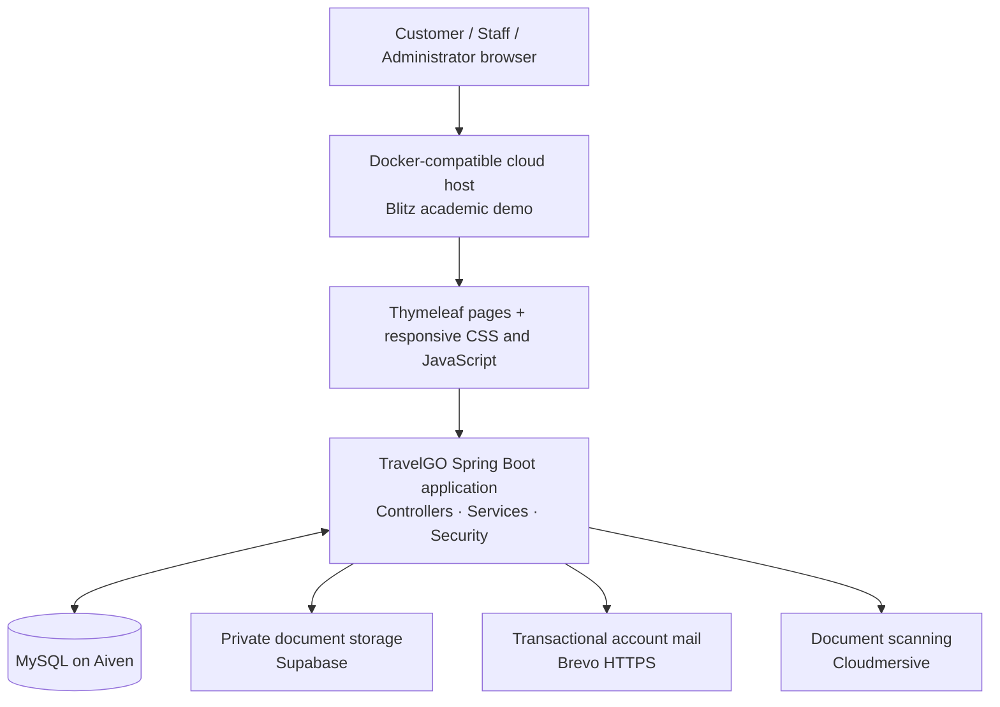

# TravelGO

> A role-based travel agency management system for discovering tours, managing bookings and visas, and coordinating customer and staff workflows.

[Architecture](docs/ARCHITECTURE.md) · [Deployment guide](docs/FREE_CLOUD_RENDER_RELEASE.md)

TravelGO is a university software-engineering project. It combines a public travel catalogue with separate workspaces for customers, travel consultants, visa officers and administrators. The current hosted version is an academic demonstration that uses fictional data only.

## Highlights

- Browse destinations and tour packages, then search and filter by destination, category, duration, price, travellers and departure date.
- Create customer accounts, verify email addresses, manage profiles and recover passwords through time-limited links.
- Create, modify, cancel and track bookings with capacity-aware departures, booking history, supplier confirmation and receipts.
- Apply for visas, upload supporting documents and track visa workflows.
- Run role-based staff operations for tour packages, destinations, hotels, transport, enquiries, bookings, payments and visa applications.
- Provide administrator dashboards for users, roles, permissions, approvals, audit logs, travel policies, system settings, content readiness and email delivery review.
- Deliver responsive public pages with a keyboard-accessible mobile navigation drawer, compressed static assets and self-hosted fonts.

## Technology

| Area | Technology |
| --- | --- |
| Language and runtime | Java 17 |
| Application framework | Spring Boot 4, Spring MVC, Spring Validation |
| Web UI | Thymeleaf, HTML, CSS, JavaScript |
| Security | Spring Security, RBAC/permissions, CSRF protection, account sessions, rate limiting and staff MFA support |
| Data | Spring Data JPA / Hibernate, MySQL, H2 for isolated tests |
| Realtime | Spring WebSocket / STOMP |
| Documents and reports | Supabase private storage, Cloudmersive scan integration, OpenPDF, Apache POI |
| Email | Brevo HTTPS transactional-mail adapter with a durable outbox |
| Payments | Simulated local demonstration checkout; Stripe and PayHere integration paths are disabled in the hosted academic demo |
| Delivery | Maven, Docker, GitHub and a Docker-compatible Blitz Cloud deployment |

## System architecture



The application follows a layered design:

```text
Browser
  └─ Controllers          Handle routes, requests, validation and views
       └─ Services        Apply booking, visa, payment and workflow rules
            └─ Repositories  Read and write JPA entities
                 └─ MySQL     Persist application data
```

See [docs/ARCHITECTURE.md](docs/ARCHITECTURE.md) for the components, data flow and security boundaries.

## Project structure

```text
Travel-Go/
├── src/
│   ├── main/
│   │   ├── java/com/travelgo/
│   │   │   ├── config/        Security, web, email and application configuration
│   │   │   ├── controller/    Public, customer, staff and admin web endpoints
│   │   │   ├── service/       Business rules and workflow orchestration
│   │   │   ├── repository/    Spring Data JPA persistence interfaces
│   │   │   ├── entity/        Domain model and database mappings
│   │   │   ├── dto/           Validated request and response objects
│   │   │   └── security/      Authentication and authorization support
│   │   └── resources/
│   │       ├── templates/     Thymeleaf page templates
│   │       ├── static/        CSS, JavaScript, images and fonts
│   │       └── application*.properties
│   └── test/                 Automated unit, MVC, security and integration tests
├── docs/                     Architecture and hosted-demo documentation
├── scripts/                  Asset build and deployment-support scripts
├── database/                 Hosted-database support scripts
├── Dockerfile.cloud-evaluation
├── pom.xml
└── README.md
```

## Roles and core workflows

| Role | Main responsibilities |
| --- | --- |
| Visitor | Explore destinations, tours, visa guidance and contact options |
| Customer | Register, verify an account, manage bookings, payments, visa requests, reviews and profile |
| Travel Consultant | Manage travel content, bookings, supplier coordination and customer enquiries |
| Visa Officer | Review visa applications, document requirements and application progress |
| Administrator | Manage users, roles, permissions, approvals, policies, settings, audit records and operational review |

## Local development

### Prerequisites

- Java 17
- Maven 3.9+
- MySQL 8+ with a schema prepared for the application

The public repository intentionally contains no database dump, user account, document, certificate or provider key. Keep secrets outside Git, for example in environment variables or a gitignored `local.properties` file.

```powershell
git clone https://github.com/dulanjanhasaranga/Travel-Go.git
Set-Location Travel-Go

# Verify the project without contacting external providers.
mvn test

# Configure a private local database before running the application.
$env:TRAVELGO_DB_URL = 'jdbc:mysql://localhost:3306/travelgo?useSSL=false&serverTimezone=UTC'
$env:TRAVELGO_DB_USERNAME = 'your_local_user'
$env:TRAVELGO_DB_PASSWORD = 'your_local_password'

# TravelGO is configured to run on port 8081.
mvn spring-boot:run
```

Open `http://localhost:8081` after a successful startup. Port 8080 is reserved for a separate project and is not used by TravelGO.

## Deployment notes

The academic deployment is designed for fictional data. A free host can sleep after inactivity, creating a cold-start delay when it starts again.

The hosted profile uses a restricted database account, TLS to Aiven, private document storage, simulated payments and disabled Google sign-in. It must not be used with real customer records, passports or payment data.

Account-verification and password-reset workflows are implemented and covered by automated tests. The project maintainer should check the Brevo delivery dashboard before claiming real recipient inbox delivery in a public release.

## Quality and security

- Role-based authorization and permission checks protect customer, staff and administrator workflows.
- CSRF protection, secure session handling and authentication abuse controls are enabled.
- Audit logs record sensitive administrative and workflow actions.
- Customer document storage is designed for private access; the hosted profile rejects public document storage.
- The cloud profile validates the existing schema and does not run automatic DDL.

## Limitations and roadmap

- Move the demo to always-on hosting before using it for an uninterrupted public presentation.
- Confirm production email delivery with a verified Brevo sender and delivery events.
- Complete a payment-provider compliance review before enabling real card payments.
- Add a CI workflow and automated deployment status checks for a production release.

## Academic use

This project is shared as a portfolio and academic demonstration. Use fictional data only, keep all provider credentials private and do not upload real travel documents or payment information.
